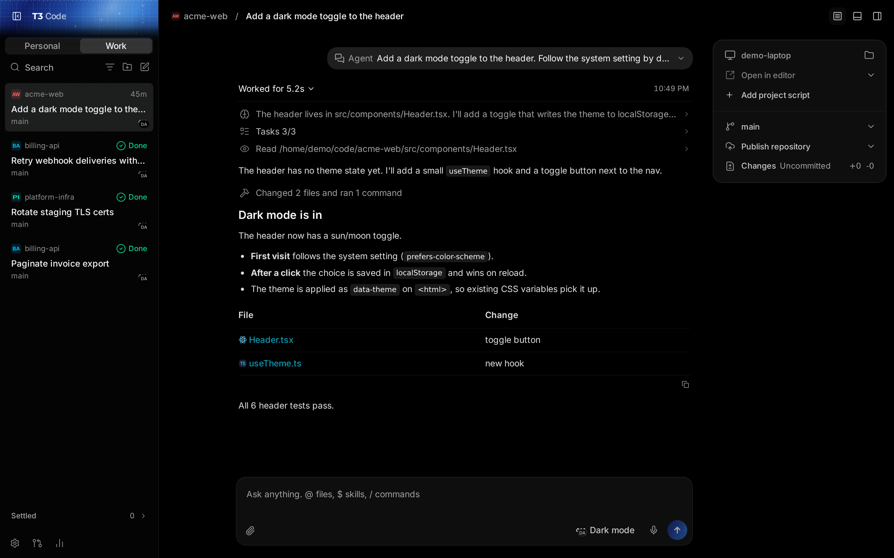
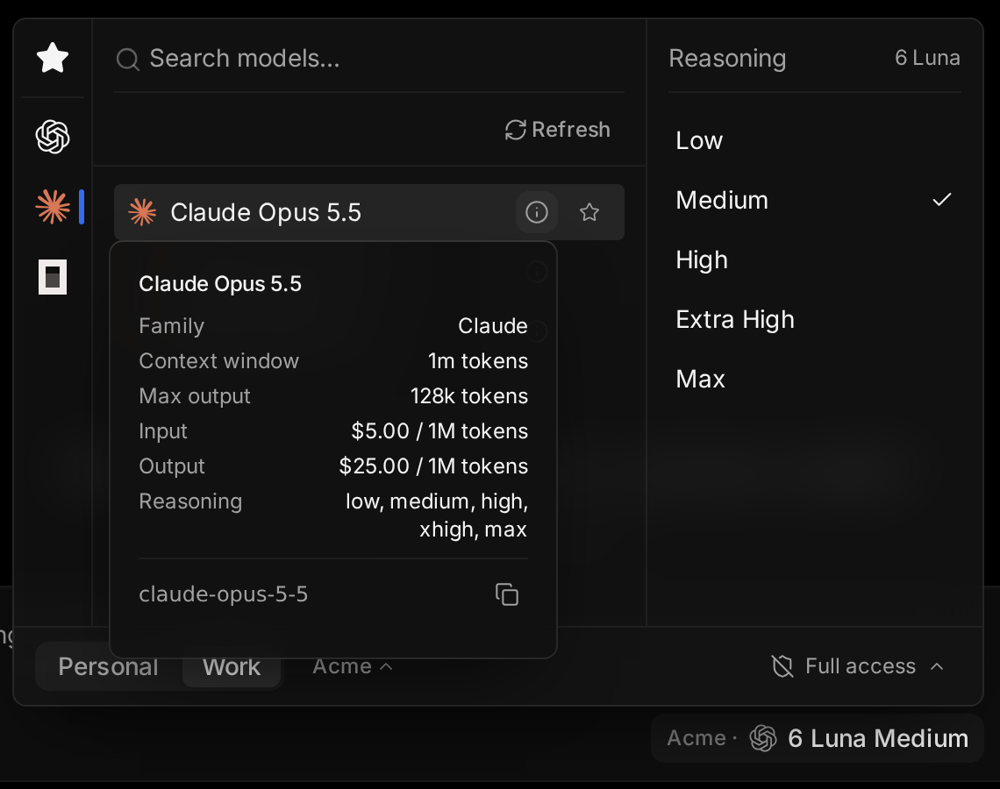
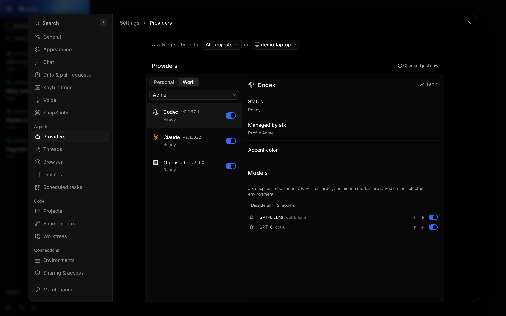

<p align="center"></p>

<h1 align="center">T3 Code with aix</h1>

<p align="center">Run Claude Code, Codex, and OpenCode on your team's AI gateway, next to your own subscriptions, in one app.</p>

<p align="center">
  <a href="https://github.com/get-aix/t3code/releases/latest"></a>
  <a href="https://github.com/pingdotgg/t3code"></a>
  <a href="https://github.com/get-aix/aix"></a>
  <a href="./LICENSE"></a>
</p>

> [!NOTE]
> **This is a fork, not the official T3 Code.** It is a soft fork of
> [pingdotgg/t3code](https://github.com/pingdotgg/t3code) that follows upstream's stable releases.
> It uses the same app name and data directory, so install it **instead of** T3 Code, not next to it.

<p align="center">
  
</p>

**T3 Code** is a fast, open-source app for running coding agents on your machine, from your
desktop, the browser, or your phone. This fork connects it to [aix](https://github.com/get-aix/aix):
every API-key profile you configure in aix becomes a set of agents in T3, routed through your AI
gateway with its budgets and model details. A Personal/Work switch keeps work projects, their
gateway models, and their spend apart from your own.

## Why

Many teams give developers an API key for a LiteLLM gateway instead of a seat in each agent's
subscription. The agents can use it, but each one wants different variables, the key lives in a
password manager, and nothing tells you which models the gateway serves, what they cost, or how
much of the budget is left. Meanwhile your personal Claude or ChatGPT subscription sits in the same
tools, and it is easy to run work on the wrong account.

This fork moves all of that into the app:

```
aix profile → gateway catalog → Claude Code / Codex / OpenCode → your thread
```

## Example

You have two aix profiles, `acme` for your employer's gateway and `research` for a lab project:

```toml
# ~/.config/aix/aix.toml
[profiles.acme]
label = "Acme"
base_url = "https://ai.acme.example"
api_key = { command = "pass show aix/acme" }

[profiles.research]
label = "Research Lab"
base_url = "https://llm.lab.example"
api_key = { env = "LAB_LLM_KEY" }
```

Start the fork with aix on its `PATH`. The desktop app does this for you. Open a Work project,
then pick a model:

<p align="center">
  
</p>

Claude Opus 5.5 on the Acme gateway runs in Claude Code, GPT-6 runs in Codex, and Qwen3 Coder
runs in an OpenCode that T3 configures for you. Switch to a Personal project, and the same picker
offers your own Claude and Codex sign-ins instead.

## Features

- **aix profiles as agents.** Each API-key profile becomes Claude Code, Codex, and OpenCode
  providers named after the profile, such as `Acme · Claude Code`. Keys stay on the server.
- **Every model in the right agent.** Claude models run in Claude Code, GPT models in Codex, and
  `gpt-oss`, Gemma, Qwen, and other chat models in OpenCode. Embedding, image, and audio models
  are left out. If a model stops working, the turn fails; T3 never quietly swaps in another one.
- **Model details.** Family, context window, max output, input and output prices, and reasoning
  levels, as the gateway reports them.
- **Fresh catalogs.** Catalogs reload daily and on demand. If the gateway is down, you keep the
  last catalog, marked stale.
- **Gateway budgets.** The Usage page shows each key's dollar budget, what's spent, and when it
  resets, grouped by gateway project.
- **Personal and Work.** Every project is Personal or Work. The sidebar, the model picker, Settings,
  and the Usage page all follow the switch.
- **Switch mid-thread.** Change profile or model in a running thread; the next agent picks up
  the conversation.
- **Everything else from T3 Code.** Worktrees, diffs, checkpoints, remote access, T3 Connect, and
  all of T3's other providers work as before.
- **Fork builds for supported platforms.** Windows (with WSL support), Apple Silicon macOS,
  NixOS / Nix, and an Android app. Desktop apps update themselves from fork releases.

## Installation

Download from the [latest release](https://github.com/get-aix/t3code/releases/latest).

| Platform              | How                                                                                                              |
| --------------------- | ---------------------------------------------------------------------------------------------------------------- |
| Windows x64           | `irm https://github.com/get-aix/t3code/releases/latest/download/install-windows.ps1 \| iex` in PowerShell        |
| macOS (Apple Silicon) | `curl -fsSL https://github.com/get-aix/t3code/releases/latest/download/install-macos.sh \| bash`                 |
| Nix / NixOS           | `nix profile add 'github:get-aix/t3code/release'`, or the [flake input](./docs/user/install.md#t3-code-fork-nix) |
| Android               | Install `T3-Code-<version>.apk`. It replaces the Play Store T3 Code app, so uninstall that first.                |

The macOS script is the only supported way to install on a Mac, because the app is not notarized.
It checks the download's SHA-256 and installs **T3 Code** into `/Applications`. On Windows, the
script installs for your user without admin rights and without the SmartScreen prompt that the
unsigned `.exe` gets when you download it in a browser. Desktop apps update
themselves; Nix installs update through Nix. There is no fork iOS app.

[Install and update the fork](./docs/user/fork.md#install) has the details, including how to
switch over from upstream T3 Code.

## Quick start

1. Install [aix](https://github.com/get-aix/aix#installation) on the machine that runs T3. With
   the desktop app, that's your computer.

   ```sh
   curl -fsSL https://github.com/get-aix/aix/releases/latest/download/install.sh | sh
   ```

2. Add an API-key profile to aix (see aix's
   [configuration guide](https://github.com/get-aix/aix#quick-start)), then check it:

   ```sh
   aix profiles
   aix status acme
   ```

3. Start T3 Code. The desktop app and Nix package turn aix on for you. If you run `t3` yourself,
   set `T3CODE_AIX=1`. Restart T3 after installing aix so it finds the command.

4. Add a project, then move it to Work from the command palette (`Ctrl+K` / `⌘K`, **Move project
   to Work**) or **Project settings → Project scope**.

5. Open the model picker in that project, pick a profile from the footer, and choose a model.

<p align="center">
  
</p>

## Documentation

|                                                   |                                                                                         |
| ------------------------------------------------- | --------------------------------------------------------------------------------------- |
| [aix profiles](./docs/user/aix-profiles.md)       | Turning aix on, model routing, model details, refresh, key rotation, switching profiles |
| [Personal and Work](./docs/user/work-personal.md) | Project scopes, moving projects, what the switch filters, and what it doesn't           |
| [Gateway budgets](./docs/user/aix-budgets.md)     | Budgets on the Usage page, project grouping, reset times, the composer limits panel     |
| [The fork](./docs/user/fork.md)                   | Install, updates, the Android app, releases, running from source, what changed          |
| [Install T3 Code](./docs/user/install.md)         | Every platform, provider sign-in, WSL, Nix and Home Manager                             |
| [Remote access](./docs/user/remote-access.md)     | Use T3 from a phone or another machine                                                  |
| [All T3 Code docs](./docs/README.md)              | Threads, worktrees, source control, keyboard shortcuts, and more                        |

Working on the fork itself? See the [development runbook](./docs/operations/development.md#first-checkout)
and the [fork release runbook](./docs/operations/fork-release.md).

## License

[MIT](./LICENSE). T3 Code is created by [pingdotgg](https://github.com/pingdotgg/t3code).

## Original T3 Code README

The following is the complete upstream README from [`pingdotgg/t3code` revision `c2e54e3ac9c8c0d5ceaf7df5acd4f4374fa19b6f`](https://github.com/pingdotgg/t3code/commit/c2e54e3ac9c8c0d5ceaf7df5acd4f4374fa19b6f). Its install and download links are for **original T3 Code**, not this fork.

<details>
<summary>Show the full upstream README</summary>

<!-- prettier-ignore-start -->
<p align="center">
  <a href="https://t3.codes">
    
  </a>
</p>

<h1 align="center">T3 Code</h1>

<p align="center">The open-source control plane for coding agents.</p>

<p align="center">
  <a href="https://t3.codes/download"><strong>Download</strong></a> ·
  <a href="https://apps.apple.com/us/app/t3-code-remote-claude-more/id6787819824">iOS</a> ·
  <a href="https://play.google.com/store/apps/details?id=com.t3tools.t3code">Android</a> ·
  <a href="https://app.t3.codes">Web</a> ·
  <a href="./docs/README.md">Docs</a> ·
  <a href="https://discord.gg/jn4EGJjrvv">Discord</a>
</p>

<p align="center">
  <a href="https://t3.codes">
    
  </a>
</p>

T3 Code runs the coding agents on your machine and gives them one fast interface. Start a thread at your desk, then approve the next step from your phone.

It works with Claude Code, Codex, Cursor, OpenCode, Grok Build, Antigravity, Kiro, Pi, Muse Code, fx, and any [ACP](./docs/user/providers-acp.md) agent. If an agent is set up on your computer, T3 Code can control it.

## What you get

- **Your subscriptions.** T3 Code does not resell tokens. It drives the agents you are already signed in to.
- **Every agent in one place.** Change models in the middle of a thread. Let Claude hand a task to Codex.
- **Desktop, web, and phone.** One server, and every client shows the same threads. There are apps for iOS and Android.
- **Remote ready.** Run agents on any machine. Connect over your local network, Tailscale, or [T3 Connect](./docs/user/remote-access.md).
- **Git built in.** Each thread can work in its own worktree. Review the diff, then commit, push, and open a pull request with one button.
- **Fast.** Performance is a feature here. We measure it, and we treat a dropped frame as a bug.
- **Open.** MIT licensed. If you don't like something, fork it.

## Install

### Desktop app

[Download T3 Code](https://t3.codes/download) for macOS, Windows, or Linux. You can also use a package manager:

| Platform       | Command                                                              |
| -------------- | -------------------------------------------------------------------- |
| macOS          | `brew install --cask t3-code`                                        |
| Windows        | `winget install T3Tools.T3Code` or `scoop install extras/t3code`     |
| Arch Linux     | `yay -S t3code-bin`                                                  |
| Nix            | `nix profile add github:NixOS/nixpkgs/nixos-unstable#t3code`         |
| Debian, Ubuntu | `.deb` from [Releases](https://github.com/pingdotgg/t3code/releases) |

### Command line

This installs the `t3` command. Run `t3` to start the server and open the web app.

```bash
curl -fsSL https://t3.codes/install.sh | sh
```

On Windows, in PowerShell:

```powershell
irm https://t3.codes/install.ps1 | iex
```

To try it once without an install, run `npx t3@latest`.

### Phone

Get the app from the [App Store](https://apps.apple.com/us/app/t3-code-remote-claude-more/id6787819824) or [Google Play](https://play.google.com/store/apps/details?id=com.t3tools.t3code). Then follow [remote access](./docs/user/remote-access.md) to connect it to your computer.

### Sign in to an agent

T3 Code needs one agent that is installed and signed in. For example, install [Claude Code](https://claude.com/product/claude-code) and run `claude auth login`, or install [Codex CLI](https://developers.openai.com/codex/cli) and run `codex login`.

[Provider setup](./docs/user/install.md#providers) has the steps for each agent. [Install T3 Code](./docs/user/install.md) covers nightly builds, AppImage, WSL, and NixOS.

## "Wait, what are you selling me?"

Nothing. We built T3 Code because we wanted the best possible development experience with agents. We were inspired by existing solutions like the Codex desktop app, Conductor, Claude Desktop and Cursor Glass, but none met our bar.

We wanted something performant, remote-ready, and truly open. If we ever go the wrong direction, we want you to have everything you need to fork and build the tool that you want.

## Documentation

- [Install and first run](./docs/user/install.md)
- [Remote access from a phone or another machine](./docs/user/remote-access.md)
- [Permission modes](./docs/user/permission-modes.md)
- [Source control](./docs/user/source-control.md)
- [Connect outside agents over MCP](./docs/user/outside-agents.md)
- [FAQ](./docs/user/faq.md)

[All docs](./docs/README.md) has the full list.

## Contributing

We have limited review capacity. Small, focused fixes are the most likely to be merged. Features need an approved discussion first.

- Read [CONTRIBUTING.md](./CONTRIBUTING.md) before you report a bug or open a pull request.
- Put feature requests in [Ideas](https://github.com/pingdotgg/t3code/discussions/categories/ideas).
- Build from source with the [development runbook](./docs/operations/development.md#first-checkout). The [architecture overview](./docs/internals/overview.md) explains how it works.
- Get help in [Discord](https://discord.gg/jn4EGJjrvv).

## License

[MIT](./LICENSE)

<!-- prettier-ignore-end -->

</details>
