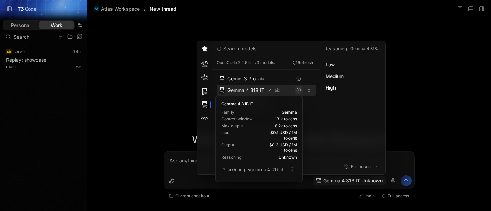
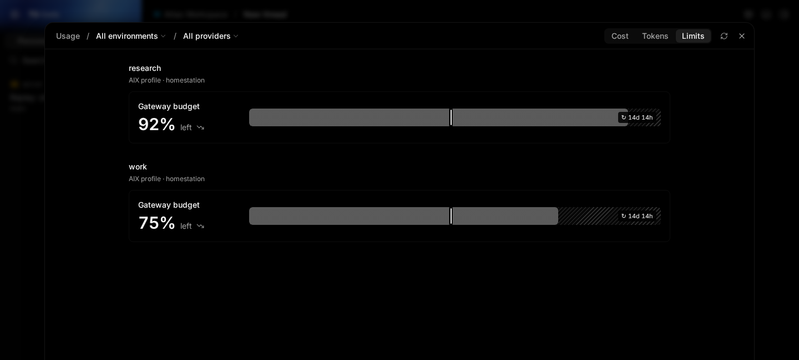
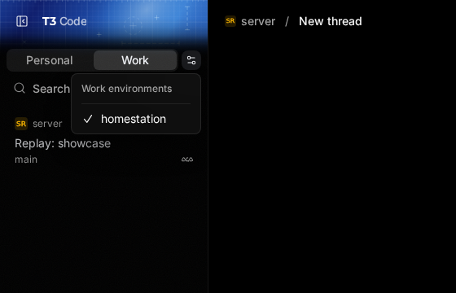

# T3 Code with aix support

A soft fork of [T3 Code](https://github.com/pingdotgg/t3code), created by pingdotgg and released under the [MIT License](./LICENSE). It keeps T3's provider, thread, and remote-work flows, and adds runtime support for [aix](https://github.com/Nitestack/aix) API-key profiles and a client-side Work/Personal view.

[Upstream T3 Code](https://github.com/pingdotgg/t3code) · [aix setup and profiles](https://github.com/Nitestack/aix#installation) · [Fork guide](./docs/user/nitestack-fork.md) · [Remote access](./docs/user/remote-access.md) · [Portable handoffs](./docs/user/portable-handoffs.md) · [MIT License](./LICENSE)

## What the fork adds

- **aix profiles as providers.** Enable with `T3CODE_AIX=1` on the server host. Each API-key profile becomes a provider instance with its own gateway endpoint. Keys stay on the server.
- **Conservative model routing.** Supported models are mapped to Codex, Claude Code, or the T3-managed OpenCode provider according to known-compatible routes. Unsupported combinations are omitted; a failed selection is not silently replaced with another provider or model.
- **Model and gateway details.** When aix or the gateway supplies them, model details include family, context and output limits, prices, and reasoning levels. Missing values appear as Unknown. A profile's LiteLLM budget window is shared by that profile's instances when the gateway reports a cap; a reset time appears when supplied.
- **Catalog refresh and client views.** Refresh aix profiles and catalogs on demand; a failed refresh keeps the last catalog marked stale. Web, desktop, and the fork's Android app can classify environments as Work and filter them from the Personal view. Classification is saved per client.

T3's existing providers, threads, provider switching and handoffs, and remote access remain available. Without `T3CODE_AIX=1`, aix integration is off and normal T3 providers work as usual.

## In the app

Captured from the fork's web client with real model IDs, demo profiles, and a local fake API. Prices, budgets, and profile names are illustrative.

### aix profiles and model details

Choose a profile's model and inspect the context window, output limits, and pricing supplied by its gateway.



### Gateway budgets

Usage limits show the budget reported for each profile, including a reset time when the gateway supplies one.



### Work and Personal views

Classify environments as Work, then switch views to filter their projects and threads. The view does not change server permissions or stop running agents.



## Set up aix and run T3

Install aix on the **machine running the T3 server**, configure an API-key profile for a gateway you can access, and make sure `aix` is on that server process's `PATH`. On Linux or macOS, the current aix README provides this installer:

```sh
curl -fsSL https://github.com/Nitestack/aix/releases/latest/download/install.sh | sh
```

Then follow aix's [installation instructions](https://github.com/Nitestack/aix#installation) for other options and its [profile configuration guide](https://github.com/Nitestack/aix#config-format) to define the profile and gateway endpoint. Check that aix can see the profile with `aix profiles`. aix-managed ChatGPT OAuth profiles are not supported by this integration.

For a source checkout, install the repository dependencies and start the development server:

```sh
git clone https://github.com/Nitestack/t3code.git
cd t3code
vp i
T3CODE_AIX=1 vp run dev --home-dir "$HOME/.t3-aix"
```

Open the local address printed at startup. `--home-dir` is the dev runner's explicit data-directory option. In linked development worktrees, state defaults to that worktree's `.t3` even if `T3CODE_HOME` is set; use `--home-dir` to choose another directory.

For the fork's pinned Nix CLI on `x86_64-linux`, `--base-dir` is the server CLI's explicit data-directory option and is equivalent to `T3CODE_HOME`:

```sh
T3CODE_AIX=1 T3CODE_HOME="$HOME/.local/share/t3code-aix" \
  t3 serve --no-browser --base-dir "$HOME/.local/share/t3code-aix"
```

The command prints pairing details for connecting another client. Keep each independent T3 server on its own data directory. The source flake and install instructions are in the [fork Nix guide](./docs/user/install.md#t3-code-fork-nix); the source checkout and development environment are covered by the [development runbook](./docs/operations/development.md#first-checkout).

## A typical workflow

Select an aix profile's model from the thread model picker. The profile and model determine the gateway endpoint and supported agent route. Open model details to review the metadata the gateway provides. Use the picker refresh control after changing aix profiles or models; if the gateway cannot be reached, T3 keeps the last catalog and marks it stale.

For a LiteLLM API key with a reported budget, check the Gateway budget window in usage limits. Classify connected environments as Work to filter them from the Personal view on that client. This classification is a client-side view preference, **not** an authentication or data boundary. For actual isolation, run separate servers with separate data directories.

## Limits and downloads

- aix integration requires API-key profiles. ChatGPT OAuth profiles remain unsupported; regular T3 provider sign-ins, including subscription-based providers, continue to work.
- Native Codex and Claude Code routing is limited to combinations known to work. The OpenCode route covers supported chat models, but arbitrary gateway aliases and model compatibility are not guaranteed. T3 does not silently substitute another model or provider.
- Model metadata may be absent. Budget windows and reset times are shown only when the gateway reports them.
- Official iOS and Android apps have no fork switch or extended model details and have not been verified against a fork server. A separately signed Android build path exists, but no fork APK has been published or device-verified. There is no fork iOS app.
- The fork's Nix flake builds from source and currently targets `x86_64-linux`; it is not a universal prebuilt binary.
- [Fork releases](https://github.com/Nitestack/t3code/releases) are empty today. The release workflow is being integrated; the intended stable release name and version follow upstream (for example, **T3 Code v0.1.9**), rather than introducing a separate fork version. The [fork release runbook](./docs/operations/fork-release.md) tracks the process. Upstream download links below install original T3 Code, not this fork.

For provider details, remote connections, troubleshooting, and mobile boundaries, see the [fork guide](./docs/user/nitestack-fork.md), [provider setup](./docs/user/install.md#providers), [remote access](./docs/user/remote-access.md), and [T3 Connect troubleshooting](./docs/user/t3-connect-troubleshooting.md).

## Original T3 Code README

The following is the complete upstream README from [`pingdotgg/t3code` revision `c2e54e3ac9c8c0d5ceaf7df5acd4f4374fa19b6f`](https://github.com/pingdotgg/t3code/commit/c2e54e3ac9c8c0d5ceaf7df5acd4f4374fa19b6f). Its install and download links are for **original T3 Code**, not this fork.

<details>
<summary>Show the full upstream README</summary>

<!-- prettier-ignore-start -->
<p align="center">
  <a href="https://t3.codes">
    
  </a>
</p>

<h1 align="center">T3 Code</h1>

<p align="center">The open-source control plane for coding agents.</p>

<p align="center">
  <a href="https://t3.codes/download"><strong>Download</strong></a> ·
  <a href="https://apps.apple.com/us/app/t3-code-remote-claude-more/id6787819824">iOS</a> ·
  <a href="https://play.google.com/store/apps/details?id=com.t3tools.t3code">Android</a> ·
  <a href="https://app.t3.codes">Web</a> ·
  <a href="./docs/README.md">Docs</a> ·
  <a href="https://discord.gg/jn4EGJjrvv">Discord</a>
</p>

<p align="center">
  <a href="https://t3.codes">
    
  </a>
</p>

T3 Code runs the coding agents on your machine and gives them one fast interface. Start a thread at your desk, then approve the next step from your phone.

It works with Claude Code, Codex, Cursor, OpenCode, Grok Build, Antigravity, Kiro, Pi, Muse Code, fx, and any [ACP](./docs/user/providers-acp.md) agent. If an agent is set up on your computer, T3 Code can control it.

## What you get

- **Your subscriptions.** T3 Code does not resell tokens. It drives the agents you are already signed in to.
- **Every agent in one place.** Change models in the middle of a thread. Let Claude hand a task to Codex.
- **Desktop, web, and phone.** One server, and every client shows the same threads. There are apps for iOS and Android.
- **Remote ready.** Run agents on any machine. Connect over your local network, Tailscale, or [T3 Connect](./docs/user/remote-access.md).
- **Git built in.** Each thread can work in its own worktree. Review the diff, then commit, push, and open a pull request with one button.
- **Fast.** Performance is a feature here. We measure it, and we treat a dropped frame as a bug.
- **Open.** MIT licensed. If you don't like something, fork it.

## Install

### Desktop app

[Download T3 Code](https://t3.codes/download) for macOS, Windows, or Linux. You can also use a package manager:

| Platform       | Command                                                              |
| -------------- | -------------------------------------------------------------------- |
| macOS          | `brew install --cask t3-code`                                        |
| Windows        | `winget install T3Tools.T3Code` or `scoop install extras/t3code`     |
| Arch Linux     | `yay -S t3code-bin`                                                  |
| Nix            | `nix profile add github:NixOS/nixpkgs/nixos-unstable#t3code`         |
| Debian, Ubuntu | `.deb` from [Releases](https://github.com/pingdotgg/t3code/releases) |

### Command line

This installs the `t3` command. Run `t3` to start the server and open the web app.

```bash
curl -fsSL https://t3.codes/install.sh | sh
```

On Windows, in PowerShell:

```powershell
irm https://t3.codes/install.ps1 | iex
```

To try it once without an install, run `npx t3@latest`.

### Phone

Get the app from the [App Store](https://apps.apple.com/us/app/t3-code-remote-claude-more/id6787819824) or [Google Play](https://play.google.com/store/apps/details?id=com.t3tools.t3code). Then follow [remote access](./docs/user/remote-access.md) to connect it to your computer.

### Sign in to an agent

T3 Code needs one agent that is installed and signed in. For example, install [Claude Code](https://claude.com/product/claude-code) and run `claude auth login`, or install [Codex CLI](https://developers.openai.com/codex/cli) and run `codex login`.

[Provider setup](./docs/user/install.md#providers) has the steps for each agent. [Install T3 Code](./docs/user/install.md) covers nightly builds, AppImage, WSL, and NixOS.

## "Wait, what are you selling me?"

Nothing. We built T3 Code because we wanted the best possible development experience with agents. We were inspired by existing solutions like the Codex desktop app, Conductor, Claude Desktop and Cursor Glass, but none met our bar.

We wanted something performant, remote-ready, and truly open. If we ever go the wrong direction, we want you to have everything you need to fork and build the tool that you want.

## Documentation

- [Install and first run](./docs/user/install.md)
- [Remote access from a phone or another machine](./docs/user/remote-access.md)
- [Permission modes](./docs/user/permission-modes.md)
- [Source control](./docs/user/source-control.md)
- [Connect outside agents over MCP](./docs/user/outside-agents.md)
- [FAQ](./docs/user/faq.md)

[All docs](./docs/README.md) has the full list.

## Contributing

We have limited review capacity. Small, focused fixes are the most likely to be merged. Features need an approved discussion first.

- Read [CONTRIBUTING.md](./CONTRIBUTING.md) before you report a bug or open a pull request.
- Put feature requests in [Ideas](https://github.com/pingdotgg/t3code/discussions/categories/ideas).
- Build from source with the [development runbook](./docs/operations/development.md#first-checkout). The [architecture overview](./docs/internals/overview.md) explains how it works.
- Get help in [Discord](https://discord.gg/jn4EGJjrvv).

## License

[MIT](./LICENSE)

<!-- prettier-ignore-end -->

</details>
