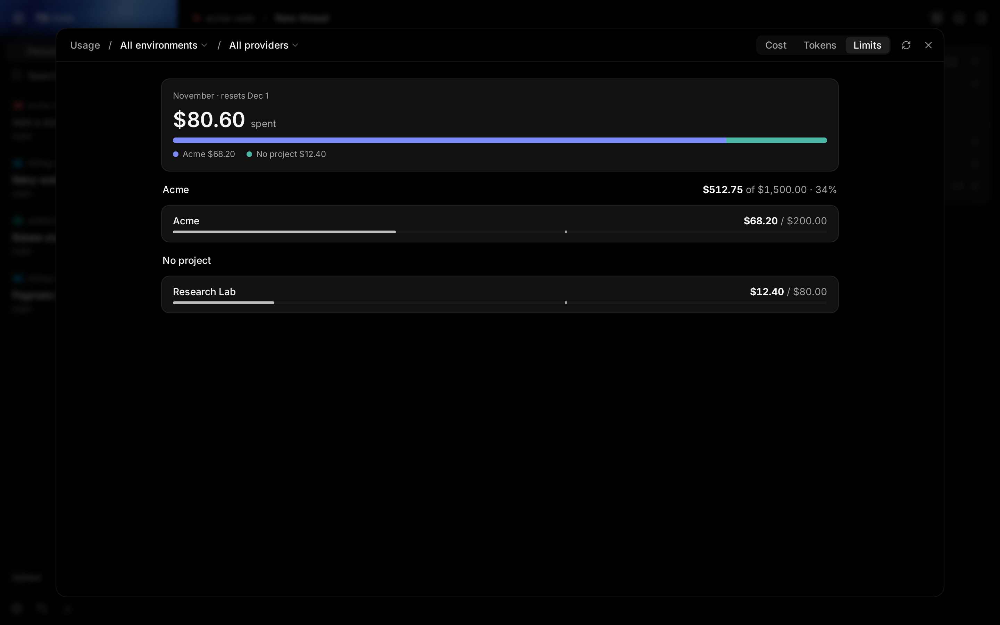

# Gateway budgets

When your gateway gives an [aix profile](./aix-profiles.md)'s key a dollar budget, T3 Code shows it:
what you've spent, the budget, and when it resets. Your team's gateway project budget appears
alongside it.

  

## See your budgets

1. Open **Usage** from the sidebar.
2. Choose **Limits**.
3. If you have usage in both scopes, choose **Work**.

The top card shows this month, the next reset date, and what all your Work keys have spent. The bar
under it splits that spend by gateway project.

Below the card, keys are grouped by gateway project:

- **The project heading** shows the project's own budget, such as **$512.75 of $1,500.00 · 34%**.
  That's everyone's spend on the project, not just yours.
- **Each key** shows its spend and budget, such as **$68.20 / $200.00**, with a bar. A tick on the bar
  marks where you'd be if you spent evenly until the reset.
- **Near limit** and **Over pace** labels flag keys close to their budget, or spending faster than
  the period allows.
- **No project** lists keys that don't belong to a gateway project.

When the gateway doesn't name a project, the group is named after the key that spent the most.

## When budgets reset

Each key shows its reset time when the gateway reports one. If the gateway reports only when the
budget period started, T3 assumes it resets monthly. The top card shows the earliest reset across
your keys.

## Check budgets from a thread

Pick `/usage-limits` from the composer's command menu to see your limits without leaving the
thread. A **Usage limits** banner opens above the composer:

- In a Work thread, it names the thread's gateway project or key, then **Work** and the reset date.
  The thread's own key comes first, then the other keys in its project.
- When you have both Personal and Work limits, the banner says **Personal and Work**, and a toggle in
  it switches between them.

The banner uses the same reading as **Usage → Limits** and closes when you dismiss it or send your
next message. To keep limits in view, turn on **Usage limits** in **Settings → Appearance → Thread
details**. See [Usage and limits](./usage.md#track-subscription-limits) for how limits work for
your own subscriptions.

## Personal and Work on the Usage page

The Usage page counts Work projects' Codex and Claude usage under Work, and the rest under Personal.
**Cost** and **Tokens** follow the same split. The Personal/Work toggle appears only when both scopes
have usage; with only one, the page shows that one.

## Keys without a budget

A key without a budget on the gateway shows no budget, and a direct Anthropic API profile shows
none either. Their cost and tokens still count under **Cost** and **Tokens**.

If budgets look out of date, refresh **Limits**. T3 checks again at most every five minutes on its
own.
