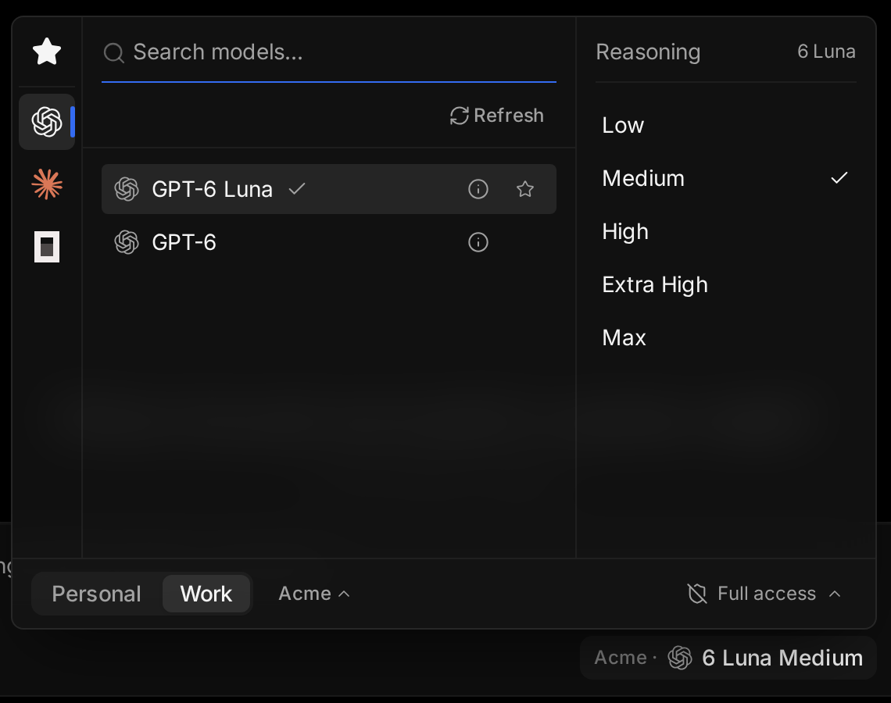
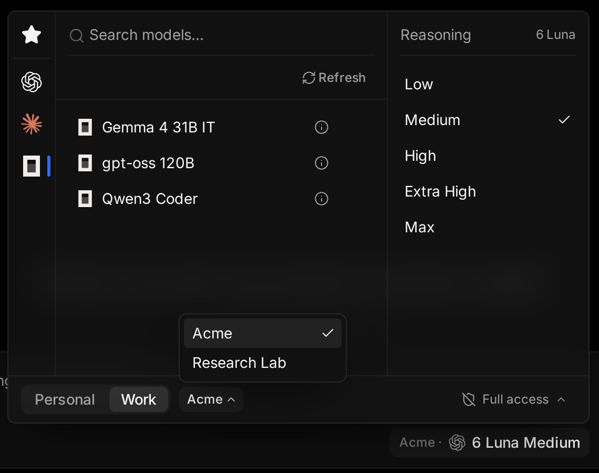
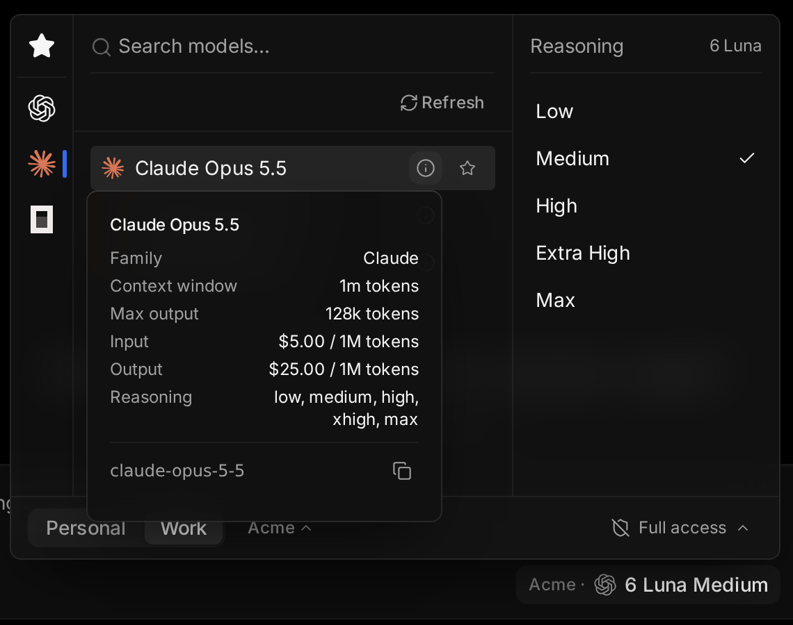
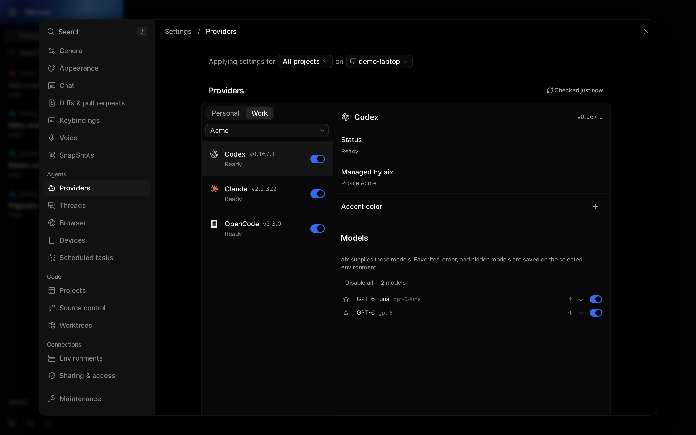
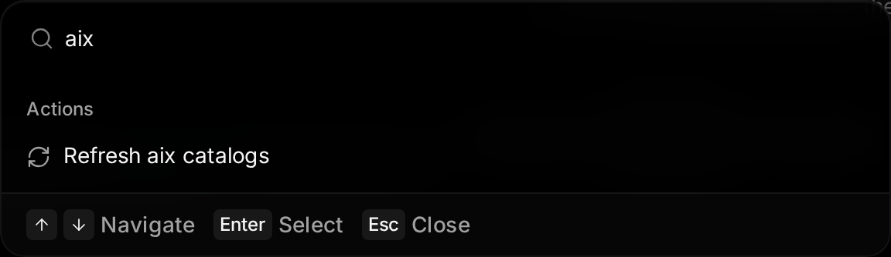

# aix profiles

[aix](https://github.com/get-aix/aix) keeps your AI gateway profiles in one place: each profile has
a gateway URL and an API key, stored in your password manager or environment. This fork turns every
API-key profile into agents in T3 Code. An `acme` profile labelled **Acme** becomes three providers:

- **Acme · Claude Code** for Claude models
- **Acme · Codex** for GPT models
- **Acme · OpenCode** for every other chat model

They appear in Work projects next to your regular providers, with the models your gateway serves.

<p align="center">
  
</p>

## Turn on aix

1. [Install aix](https://github.com/get-aix/aix#installation) on the machine that runs the T3
   server. With the desktop app, that's your computer. With a remote server, it's the server.
2. Add an API-key profile and check that it works:

   ```sh
   aix profiles
   aix status acme
   ```

3. Start T3 Code with aix turned on:
   - The **desktop app** and the **Nix package** turn aix on for you.
   - If you run `t3` or `t3 serve` yourself, set `T3CODE_AIX=1` in its environment.
   - To turn it off, set `T3CODE_AIX=0`. T3 then behaves like upstream T3 Code and disables the aix
     providers it created. Your own sign-ins don't change.
4. Restart T3 after installing aix, so it finds the `aix` command on its `PATH`.

Your keys stay on the server. T3 asks aix for each profile's endpoint and key when it starts an
agent. It never writes them to T3 settings or sends them to clients, including remote browsers and
phones.

ChatGPT sign-in profiles aren't supported. Keep using the regular Codex provider for a ChatGPT
subscription.

## Pick a model

aix models show up in **Work** projects. Personal projects show your own subscriptions; see
[Personal and Work](./work-personal.md).

1. Open a thread in a Work project.
2. Open the model picker under the composer.
3. Choose a profile in the picker's footer. With several profiles, the footer lists each one.
4. Choose an agent tab (Codex, Claude, OpenCode), then a model.

<p align="center">
  
</p>

Press the details button beside a model to see its details:

- **Family**, such as Claude, GPT, or Qwen
- **Context window** and **max output** in tokens
- **Input** and **output price** per million tokens
- **Reasoning levels** the model accepts

Values the gateway doesn't report show as **Unknown**.

<p align="center">
  
</p>

New threads start with the project's last selection, like any other provider.

## Which agent runs a model

T3 picks the agent from the model's family:

| Model                                              | Agent       |
| -------------------------------------------------- | ----------- |
| Claude models, from a gateway or the Anthropic API | Claude Code |
| GPT models from a LiteLLM gateway                  | Codex       |
| Open-weight `gpt-oss` models                       | OpenCode    |
| Other chat models, such as Gemma, Qwen, or Llama   | OpenCode    |

- A direct Anthropic API profile offers Claude models only.
- T3 configures OpenCode for each profile. You don't need an OpenCode login or config file.
- Embedding, image, audio, and wildcard routes aren't listed.
- T3 sends the gateway the model's original ID.

If a model or profile stops working, the turn fails with an error. T3 never switches to another
model or agent for you.

## See aix providers in Settings

**Settings → Providers** lists every provider instance. Choose **Work** at the top, then a profile
from **Work profile**, to see that profile's Codex, Claude, and OpenCode instances, their status,
and their models. You can turn an instance off there. It stays off, even after the profile reloads.

<p align="center">
  
</p>

## Refresh catalogs and rotate keys

T3 loads your profiles and each gateway's model catalog when the server starts, then reloads them
once a day. To reload right away, for example after adding a profile or after your gateway adds a
model:

- Press **Refresh** in the model picker, next to the profile's catalog status, or
- Open the command palette (`Ctrl+K` / `⌘K`) and run **Refresh aix catalogs**.

<p align="center">
  
</p>

What happens on reload:

- **A new profile** gets its providers.
- **A deleted profile** has its providers disabled. They come back if the profile returns, unless you
  turned them off yourself.
- **A failed reload** keeps the last catalog. The picker shows **Stale catalog** with the error.

A rotated key needs no reload. T3 asks aix for the key each time it starts an agent, so the next
agent uses the new key. A turn that's already running keeps the process it started with.

## Switch profile or model in a thread

Pick another aix model in a thread's model picker, from the same profile or another one. The next
agent gets the conversation through a [portable handoff](./portable-handoffs.md) and continues from
there; it doesn't resume the previous agent's session.

A change made while a turn runs applies from your next message. It doesn't stop the running turn.

## Troubleshooting

**No aix models in the picker.** Check that the project is in Work, and that the footer shows a
profile. Then check that aix works for the user that runs T3: `aix profiles` lists the profile and
`aix status <profile>` succeeds. Restart T3 if you installed aix after starting it. Outside the
desktop app and Nix package, check that `T3CODE_AIX=1` is set.

**Stale catalog or Catalog unavailable.** The last reload couldn't reach the gateway or read the
key. Fix the cause shown in the message, then press **Refresh**.

**Provider shows as unavailable in Settings.** Press **Refresh provider status** in Settings →
Providers. A check can time out while the machine is busy starting up.

**A turn fails right away.** The model may have been removed from the gateway, or the key may have
run out of budget. Check the error, the key's budget on the [Usage page](./aix-budgets.md), and
`aix status <profile>`.
