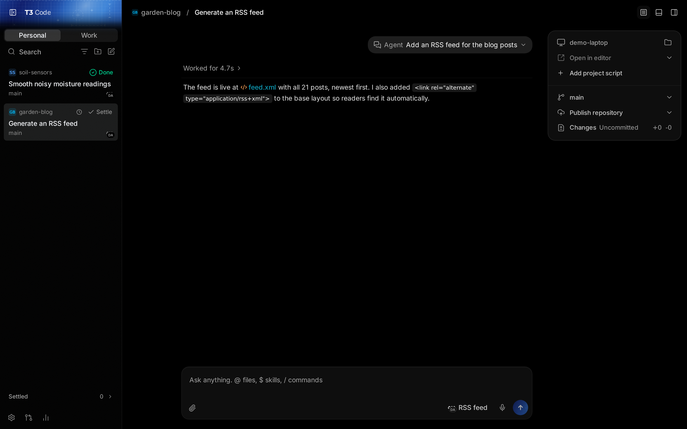
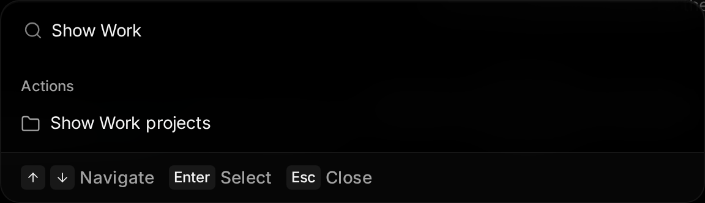
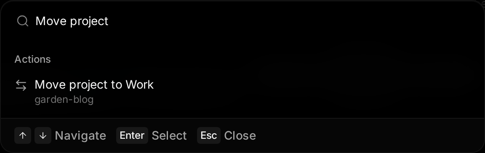
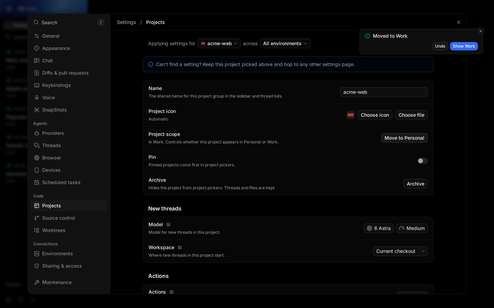
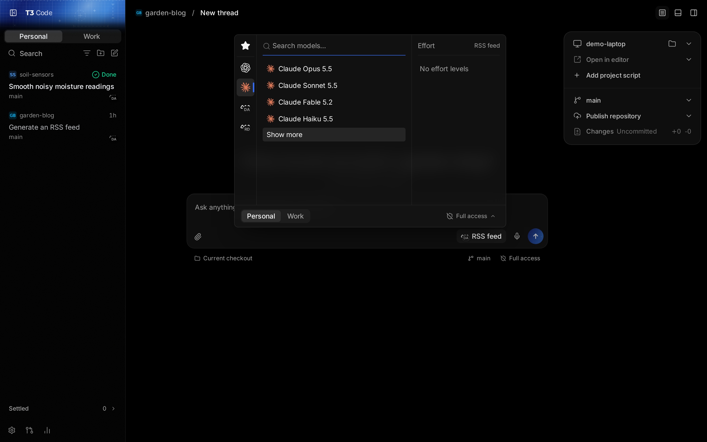

# Personal and Work

Every project in this fork is either **Personal** or **Work**. The switch at the top of the sidebar
picks which one you see, and the rest of the app follows it:

- **Personal** shows your own projects and your own subscriptions, such as your Claude or ChatGPT
  sign-in.
- **Work** shows work projects and the [aix profiles](./aix-profiles.md) for your company's gateway.

Work stays on the gateway, and your personal projects stay on your own subscriptions.

  

## Switch scopes

Use the **Personal / Work** switch at the top of the sidebar. The sidebar, search, and project
choices update right away. Running turns keep running.

The command palette (`Ctrl+K` / `⌘K`) has the same switch: **Show Work projects** or **Show
Personal projects**.

  

Each client remembers its own choice. Your desktop app can show Work while your phone shows
Personal.

## Move a project

Projects without a scope are Personal, including every project from before you installed the fork.
To move one, use any of these:

- **Sidebar:** right-click the project, then choose **Move to Work** or **Move to Personal**.
- **Command palette:** run **Move project to Work** or **Move project to Personal**. The command
  names the project it moves.
- **Project settings:** under **Project scope**, press **Move to Work** or **Move to Personal**.
- **Android app:** open the project in Settings, then press **Move to Work** or **Move to
  Personal**.

  

The project and its threads move together. A toast confirms the move, with **Undo** to move it back
and a button to show the other scope.

  

New projects take the scope you're looking at. Add a project while viewing Work, and it's a Work
project.

## The model picker follows the scope

In a Work project, the model picker opens on Work and lists your aix profiles. In a Personal
project, it opens on Personal and lists your own providers.

  

The picker has its own Personal/Work toggle. Use it to pick a model from the other scope for one
thread, for example to try a personal model on a work project. If a thread already uses a model
from the other scope, the picker keeps showing it until you pick another model.

**Settings → Providers** has the same toggle, plus a **Work profile** menu to choose which aix
profile's providers you see.

The [Usage page](./aix-budgets.md) counts Work projects' usage under Work, and personal usage under
Personal.

## Keys and approvals

A Work project has a **Work key**, the [aix profile](./aix-profiles.md) its agents use by default.
Set it in **Project settings → Work key**.

Agents can use other keys too, but only when you allow it:

- **Sending on another key.** If you send a message with a model from a different key, T3 Code asks
  first. Confirm to send, and that key joins the thread. Cancel keeps your message as it is.
- **An agent asking for a key.** When an agent wants to run work on another key, you decide on its
  card. **Deny** refuses it. **Allow this task** covers that one run. **Allow for this thread** covers
  the thread from then on, and you can revoke it from the card.
- **Allowing keys up front.** For an unattended run, approve keys before it starts. Open the model
  picker in the thread, where the keys the thread's agents may use are listed. Use **Allow another
  key…** to add one, and **Remove** to take it back.

The key list appears once a thread has sent its first message. Before that, a key is allowed when you
send with it and confirm.

## What the scope filters

The scope filters:

- Projects and threads in the sidebar
- Thread and project search
- Project choices, such as the project chooser for a new thread
- The model picker's starting scope
- Settings → Providers and the Usage page

It doesn't filter:

- Running turns and queued work, which keep running in either scope
- Notifications
- Shared preferences such as the theme and keyboard shortcuts

## Scopes aren't access control

A scope is a label on the project, stored on its server. Anyone who can connect to that server can
see and use both scopes. It doesn't keep data apart.

For real separation, run two T3 servers with their own data directories, each with its own
`T3CODE_HOME`. The [Nix install guide](./install.md#t3-code-fork-nix) shows one way. One client can
connect to both.

## Clients

The switch works on web, desktop, and the fork's [Android app](./fork.md#the-android-app). The
official iOS and Android apps, and clients older than the fork, show all projects together and
can't move them. Moving a project also needs a fork server and permission to change its projects.
